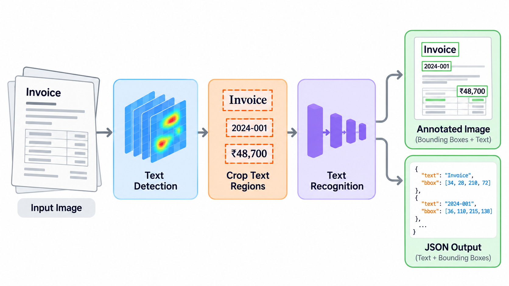
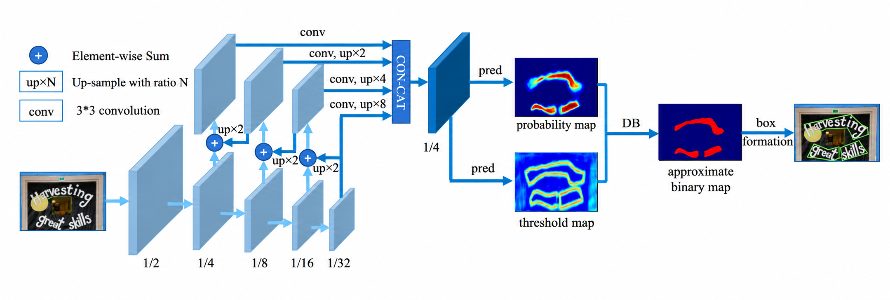
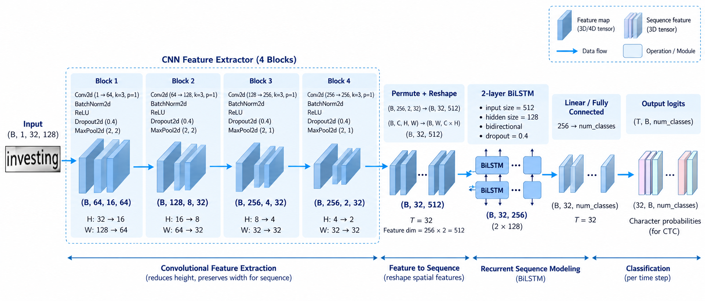

::: {.callout-tip}

### References

- This is mostly based on:
    1. [DB](https://github.com/MhLiao/DB)
    2. [DBNet Paper](https://arxiv.org/abs/1911.08947)
    3. [Rajesh Shreedhar Bhat's Article](https://forge.coreweave.com/wandb/authors/text-recognition-crnn-ctc/reports/Text-Recognition-With-CRNN-CTC-Network--VmlldzoxNTI5NDI)
- Datasets [Text Detection]
    1. [TextOCR dataset](https://textvqa.org/textocr/dataset/)
    2. [TD TR data](https://paddleocr.bj.bcebos.com/dataset/TD_TR.tar)
- Datasets [Text recognition]
    1. [IIIT5K-Words](https://www.kaggle.com/datasets/prathmeshzade/iiit5k-words)
    2. [MJSynth](https://www.robots.ox.ac.uk/~vgg/data/text/)
:::

- Implementation accompanying these notes:
  - [nanoOCR implementation](https://github.com/riteshrm/nanoOCR)

# Motivation

The goal of this project was to understand how OCR works, how we train these models, evaluate them, and deploy them efficiently.

Generally, OCR modules consist of two components:

1. **Text Detection**:- It is responsible for detecting the text regions from an image.
2. **Text Recognition**:- It is responsible for recognizing the text present in the given image.

<figure style="text-align: center;">
  
  <figcaption>An overview of how OCR works</figcaption>
</figure>

We will start with text detection and then we will move on to text recognition, where, in each case, we will start by first exploring why we need this module and what it predicts, then explore how we train it and evaluate it, and then the data needed to train the model and how we get the expected data representation from the raw dataset.

# Text Detection

## Overview

- This module is responsible for detecting the textual regions.
- Basically, given an image, it gives multiple bounding boxes which contain text.
- This is completely based on DBNet, which gives the probability of each pixel being a textual region.

## [Model](https://github.com/riteshrm/nanoOCR/blob/main/src/det_model/model.py#L485)

- This module consists of a ResNet-based backbone, which extracts features from a given image at 4 resolutions, which are generally /32, /16, /8 and /4.
- Then these extracted features pass through independent convolution networks, which make all these features have the same number of channels.
- Now we take the /32 resolution, upsample it to make it similar to /16, add it, and then upsample it to get /8, which is added to /8, and then we repeat for /4.
- After this, we have features at /32, /16, /8 and /4 which contain more low-level features as we move from /32 to /4. At the same time, they also incorporate global features through previous upsampling and addition process.
- Now we upsample all these 4 features to have the same resolution, then we concatenate them along the channel dimension.
- These features are passed through a network which gives the probability of textual regions in the image.
- There are two other components, which are used only while training:
    - A thresh predictor, which gives some adaptive threshold which is finally being used to produce a binary map
    - This thresh predictor takes the concatenated feats and the probability and gives some threshmap
    - Using the probability and threshmap, we get thresh binary, where 1 tells us about the textual region and 0 tells us about the background

<figure style="text-align: center;">
  
  <figcaption>DBNet Architecture</figcaption>
</figure>

## Dataset & Preprocessing

### TD TR

- Images and a corresponding bounding box per line with labels 0 and 1, where 0 means suitable for detection and 1 indicates difficult text regions
- I split the training set into training and validation sets

### TextOCR

- Images and corresponding bounding boxes which I needed to extract from the given json files
- Neglected those lines which were not rectangles and also, to make it consistent with TD TR, appended 0 at the end of each line.

### Preprocessing

- During training time, I needed training targets corresponding to the predicted probability, thresh and thresh binary.
- I needed a pipeline to generate the required training labels from an image and its corresponding bounding box.
- Used DBNet repo's files to do so and the code inherited from that repo can be found [here](https://github.com/riteshrm/nanoOCR/blob/main/src/data/det_data_processing.py)

- Let’s explore the main components from that file

#### [RandomCropData](https://github.com/riteshrm/nanoOCR/blob/main/src/data/det_data_processing.py#L20)

Let’s see how it processes a given image and corresponding polygons of textual regions:-

1. It calls crop_area, which basically returns crop_x, crop_y [top left] and crop_w, crop_h [width from left, height from top]
2. crop_area finds out the consecutive regions where text is not there and then selects points from those regions; basically, it selects cols from different consecutive regions and as soon as it finds a polygon it returns that crop.
3. Then calculate scale_w, scale_h and define scale as min(scale_h, scale_w) and use that scale to calculate w, h
4. Take out the crop from the original image using the values returned by crop_area
5. Resize the cropped_image to w, h
6. Create a black image of the required size
7. Assign the cropped image to the created black image
8. The final image might contain black padding on the bottom or right of the image.
9. Using the scale and crop_x, crop_y, we now have to change the coordinates of the polygons also
10. `new_coords = (old_coords - (crop_x, crop_y)) * scale`
11. Check if this new polygon is within the cropped image or not. If not, then truncate to (0, 0, w, h)

#### [MakeSegDetectionData](https://github.com/riteshrm/nanoOCR/blob/main/src/data/det_data_processing.py#L168)

- Given an image and the polygons, it gives gt[1: text region, 0: background], mask[1: pixel to be considered while training, 0: Ignore]

#### [MakeBorderMap](https://github.com/riteshrm/nanoOCR/blob/main/src/data/det_data_processing.py#L259)

- Given an image and the polygons, it gives thresh_map[which contains values between 0.3 and 0.7, the value is larger closer to the boundary of the polygon and it decreases as we move away from the boundary], thresh_mask[1: train at this pixel considering thresh_map, 0: Ignore]

#### [NormalizeImage](https://github.com/riteshrm/nanoOCR/blob/main/src/data/det_data_processing.py#L376)

- Normalizes the pixel values as per the requirements of ResNet; in DBNet, ResNet is being used as the backbone

Now, after all this preprocessing, we get our training dataset as:-

1. cropped Image
2. Transformed Polygons
3. gt[1: text region, 0: background]
4. mask[contains 1 everywhere except small polygons]
5. thresh_map [creates a boundary around the lines of polygons with closer points having a value of 0.7 and further points a value of 0.3]
6. thresh_mask [1: to consider thresh_map training, 0: Ignore]

and Val/Test as:-

1. Resized_image considering the aspect ratio
2. Polygons in original Image
3. original Image Shape

## Loss Functions

- Now we have got the model architecture and data; let’s see the loss functions which are being used in DBNet.

### [Balanced CELoss](https://github.com/riteshrm/nanoOCR/blob/main/src/det_model/loss.py#L6)

- It takes pred[probability of a pixel being a text region], gt[contains 1 where text is], mask[contains 1 where the model needs to consider pixels]
- Before moving on to loss calculation, let’s consider positives as text regions and negatives as background

1. `positive = (gt x mask)`[gives text area]
2. `negative = ((1-gt) x mask)`[gives background]

- Now we don’t want our model to consider all the background pixels since an image might contain a very large area which does not have text, and at the same time we want the model to consider hard pixels, i.e., where it is not so sure between text and background
- To do so, we define a negative ratio which tells how many negative pixels we can consider per positive pixel
- It has been defined in DBNet to be 3, i.e., at most 3 negative pixels per positive pixel

4. `positive_count = positive.sum()`
5. `negative_count = min(negative.sum(), positive_count x negative_ratio)`
6. `loss = ce_loss(pred, gt, reduction='None')`

- Notice one thing: generally, we pass reduction as mean but here we are passing it as None, because it will otherwise consider all the positive as well as negative regions.

7. `positve_loss = (loss x positive)`[ it will consider only the text region]
8. `negative_loss = (loss x negative)`[ it will consider background]

- Now we have got the loss for both the regions, but we need to select the hardest ones from negative_loss

9. `negative_loss = topk(negative_loss.view(-1), negative_count)` [selects harder pixels for background]
10. `loss = (positive_loss.sum() + negative_loss.sum())/(positive_count, negative_count + 1e-6)` [1e-6, so that we don’t divide by 0]

### [MaskL1Loss](https://github.com/riteshrm/nanoOCR/blob/main/src/det_model/loss.py#L59)

- It takes thresh[predicted by the model], thresh_map[data], thresh_mask[data] and calculates L1Loss considering only those pixels where thresh_mask contains 1

### [DiceLoss](https://github.com/riteshrm/nanoOCR/blob/main/src/det_model/loss.py#L72)

- It takes thresh_binary[predicted by the model], gt[data], mask[data] and tells how the predicted binary map coincides with the actual text regions.
- We calculate the dice score as:-
- `2 x (intersection)/(pred area + actual area)`
  - where `intersection = sum(thresh_binary * gt * mask)`
  - `pred_area = sum(thresh_binary * mask)`
  - `actual_area = sum(gt x mask)`

- Now we need to maximize this score, but in ML we generally minimize loss,
  so we can define diceloss as 1 - dice score

- So you can think of these as follows: Balanced BCE is considering pixel by pixel, whereas diceloss is considering the overall map loss.

- And our final loss is a weighted sum of all these and is defined as
  - `loss = 5 x balanced_ce_loss + 10 x l1_loss + dice_loss`

## [Postprocessing](https://github.com/riteshrm/nanoOCR/blob/main/src/eval/seg_detector_representer.py#L24)

- During inference, given an image, the model predicts the probability of textual regions
- We get a segmentation map using pred (1 is pred>0.3)
- Now, using segmentation, find contours (basically regions containing 1s)
- Decide the final number of contours depending on the len(contours) returned by OpenCV and max candidates to be considered.
- Initialize boxes, scores
- Now, for each candidate:
  - get the points and shortest_side
    - if shortest_side < 3 then reject this candidate
  - get the textual probability of the current polygon
    - if it is less than the threshold then reject it
  - If both checks pass, expand the polygon

- Finally, scale the coordinates by:-
  - `cords = predicted_coord/ predicted_width X destination width`
- Now we have predicted boxes and corresponding scores

## [Evaluation](https://github.com/riteshrm/nanoOCR/blob/main/src/eval/iou.py#L11)

- Now we have got the predicted boxes and corresponding scores, and we also have ground truth boxes.
- Now, using the ground truth and predicted polygons, we calculate precision, recall and F1 based on the IoU (Intersection over Union)
- Basically, we try to find out how many ground truth polygons and predicted polygons have IoU > the threshold (which is 0.5) and also, at the same time, avoid mixing one already mapped polygon with any other corresponding ones
- Now we get true positives, which indicate how many of all the predicted boxes overlapped with the ground truth.
- And using that value, we calculate precision as the number of true positives/number of predicted boxes and recall as the number of true positives / number of ground truth boxes and finally get hmean using precision and recall

### Benchmarking Environment

All evaluation metrics and latency measurements below were measured on CPU, using the same evaluation datasets for each model across PyTorch FP32, ONNX Runtime FP32, and ONNX Runtime INT8.

- **Environment:** Ubuntu on WSL2
- **CPU:** Intel(R) Core(TM) i7-9750H CPU @ 2.60GHz
- **CPU threads:** 4
- **Batch size:** 1
- **Warmup:** 20 forward passes
- **Latency measurement:** Forward pass only, excluding preprocessing and postprocessing.

### Results

Results on the TDTR test set:

| Model format | Precision | Recall | H-mean | Mean latency (ms) | Median latency (ms) | P95 latency (ms) |
| --- | --- | --- | --- | --- | --- | --- |
| INT8 ONNX | 0.293 | 0.363 | 0.324 | 214.704 | 214.029 | 247.256 |
| FP32 ONNX | 0.296 | 0.373 | 0.330 | 224.976 | 220.783 | 261.635 |
| FP32 PyTorch | 0.296 | 0.373 | 0.330 | 290.916 | 285.088 | 326.251 |

# Text Recognition

## Overview

- This module is responsible for recognizing text from a given cropped image.
- This is completely based on a CRNN type of architecture

## [Model](https://github.com/riteshrm/nanoOCR/blob/main/src/rec_model/model.py#L63)

- This module consists of two main submodules: one is based on CNNs, which are responsible for extracting visual features from a given image, and the other is BiLSTM-based, which takes in those features and gives the probability of the characters at predefined time steps.

<figure style="text-align: center;">
  
  <figcaption>CRNN Architecture[Generated by ChatGPT]</figcaption>
</figure>

## Dataset & Preprocessing

### IIIT5K

- It contains images and csv files where the csv files have the image filename and the corresponding chars
- It has 2K train and 3k test samples

### MJSynth

- It also contains images and the text present in the image is embedded in the image file name
- I used 50K samples from this which I divided into 45k train, 2.5K val and 2.5K test

### [Preprocessing](https://github.com/riteshrm/nanoOCR/blob/main/src/data/rec_data_processing.py)

- Given images and corresponding data, the file creates separate CSV files for each dataset, along with a combined CSV file.
- It also creates a vocab of size 63 [26 lowercase letters + 26 uppercase letters + 10 digits + blank]
- It also creates two mappings, namely itoc, which is integer to character, and ctoi, which is the reverse of itoc

## Loss Functions

- Now we have got the model architecture and data; let’s see the loss functions which are used in this case.

### [CTC Loss](https://docs.pytorch.org/docs/2.14/generated/torch.nn.CTCLoss.html)

- I didn't get much into the maths of this loss;
  I just followed PyTorch's doc on how this function expects all the inputs to calculate the loss.

- T=Input length, N=Batch Size, C=No. of Classes
- Log_probs:- an input of shape [T, N, C]
- Targets:- Either (N, S) where S is the max seq_len and use pad tokens if any sequence is less than the max seq_len or concatenate all the labels in a single array
- Input_lengths:- (N, ) all the inputs have the same length (T)
- Target_lengths:- (N, ) an array containing the lengths of all labels

## [Postprocessing](https://github.com/riteshrm/nanoOCR/blob/main/src/utils/utils.py#L58)

- The idea is very simple: collapse consecutive repeated tokens and then remove blanks

## [Evaluation](https://github.com/riteshrm/nanoOCR/blob/main/src/utils/utils.py#L94)

- Now we have got the predicted text and ground truth; we calculate the character error rate.
- Basically, it calculates the minimum number of deletions, insertions and replacements we can apply to the predicted text to make it similar to the ground truth text

### Results

The recognition model uses the same benchmarking environment and measurement settings as the detection model.

Results on the IIIT5K test set:

| Model format | CER | Character precision | Character recall | Exact word-match accuracy | Mean latency (ms) | Median latency (ms) | P95 latency (ms) |
| --- | --- | --- | --- | --- | --- | --- | --- |
| INT8 ONNX | 0.1429 (14.29%) | 87.72% | 87.54% | 68.90% (2067/3000) | 2.453 | 2.412 | 3.078 |
| FP32 ONNX | 0.1441 (14.41%) | 87.47% | 87.45% | 68.90% (2067/3000) | 3.030 | 3.022 | 3.975 |
| FP32 PyTorch | 0.1441 (14.41%) | 87.47% | 87.45% | 68.90% (2067/3000) | 6.146 | 5.717 | 8.185 |

# Limitations and Future Work

The current implementation has several areas for improvement:

1. **Detection accuracy:** The detector currently achieves an H-mean of approximately 0.33, which limits overall text detection performance. Further training could improve performance.
2. **Recognition accuracy:** The recognizer achieves approximately 68.9% exact word-match accuracy on the IIIT5K test set. Further training could improve performance.
3. **Model architecture:** The initial goal was to establish a working baseline. Lightweight backbones such as LCNetV4 from PPOCRv6 and EfficientNet-inspired architectures have not yet been explored and could improve the trade-off between accuracy and latency.
4. **Training data:** Increasing the training sample size improved generalization for both models. Additional training data, augmentation, and hyperparameter tuning could improve it further.
5. **Quantization:** INT8 quantization reduced mean latency, with a small decrease in detection accuracy and a small improvement in recognition CER. Further profiling could identify bottlenecks and help guide the exploration of other quantization strategies.
